<div align="center">


# SocketForge

### What is using that port?

A local ports viewer and hosts-file editor for Windows, written in **Rust**.
See every listening port with the program behind it and whether it is reachable from the network, find a free port, edit the hosts file safely, serve a folder over HTTP and forward a local port.

<p>
  
  
  
  
</p>

<p>
  
  
  
  
  
  
</p>

[**Features**](#-features) ·
[**Screenshots**](#%EF%B8%8F-screenshots) ·
[**Download**](#-download) ·
[**Command line**](#%EF%B8%8F-command-line) ·
[**Limits**](#-good-to-know) ·
[**Changelog**](CHANGELOG.md) ·
[**Developer**](#-developer)

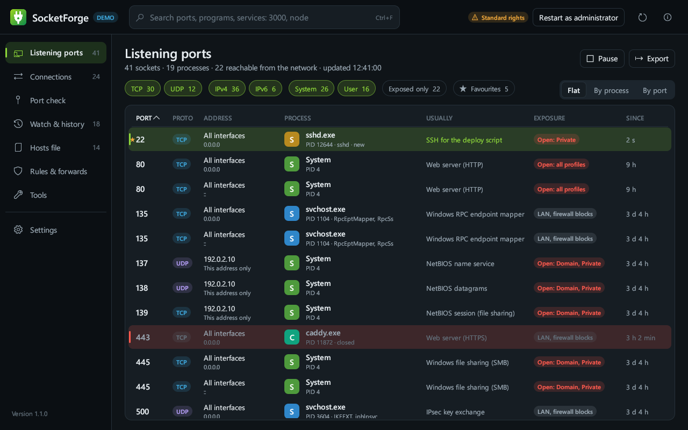

</div>

---

## ✨ Features

<table>
<tr>
<td width="50%" valign="top">

### 🔌 Listening ports
- Every listening TCP and UDP port, IPv4 and IPv6
- The program behind it: name, PID, path, command line, and the service inside `svchost`
- What the port is usually for
- **Exposure:** this PC only, local network, or open through the firewall and for which profiles
- Flat, by process or by port; search "3000", "node", "postgres"
- **Your own notes and favourites:** star a port, give it a note, and filter by the star

</td>
<td width="50%" valign="top">

### 🔁 Connections and history
- Active connections with local and remote endpoints, state and program
- Live refresh: new rows in green, closed ones fading in red
- **Watch and history:** when ports opened and closed
- Alert when a new listener appears or a watched port is taken

</td>
</tr>
<tr>
<td valign="top">

### 🔍 Port check and free ports
- **Who is using port N?** in one box
- Explains why a port can fail to bind even when nothing listens (reserved ranges, URL reservations)
- **Free port finder:** the next free port from a number, or a range
- Test a local port and read its first bytes

</td>
<td valign="top">

### 📝 Hosts file editor
- Table view with on/off switches for each entry
- Add, edit, delete, group and search; right-click to copy
- Duplicate and syntax checks, and **Remove duplicates** in one click
- **Block-list import:** hosts-style lists, plain name lists and `||name^` rules, each name added once
- Raw text view; long files open in a fast view with line numbers
- **Automatic timestamped backups** and one-click restore
- **Profiles:** sets of entries to switch on and off together, such as "dev" and "staging"
- **DNS cache:** what Windows remembers, with a Flush button

</td>
</tr>
<tr>
<td valign="top">

### 🧱 Rules and forwards (read-only)
- Firewall rules for a port or program
- Port proxy rules and URL reservations
- Reserved and dynamic port ranges
- Docker and WSL port forwards

</td>
<td valign="top">

### 🧰 Actions and export
- End a process or stop a service, with a confirmation showing what else it serves
- Open file location, copy `host:port`, open `http://localhost:port`
- Export to CSV, JSON and HTML
- Dark and light themes

</td>
</tr>
<tr>
<td valign="top">

### 🌐 Serve a folder over HTTP
- Pick a folder and a port, press Start, open `http://localhost:port/`
- File listing for folders without an `index.html`
- The latest requests with their status
- This PC only by default; one switch shares it with your network

</td>
<td valign="top">

### 🔀 Forward a local port
- Listen on one port and pass every connection on to another address
- Reach a database on another machine as `localhost`
- Open connections, totals and the last error at a glance
- No administrator rights, nothing changed in Windows, gone when stopped

</td>
</tr>
</table>

## 🖼️ Screenshots

<table>
<tr>
<td width="50%" align="center"><b>Connections</b><br>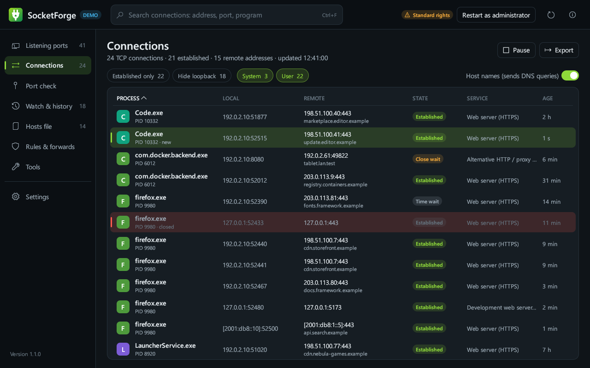</td>
<td width="50%" align="center"><b>Port details</b><br>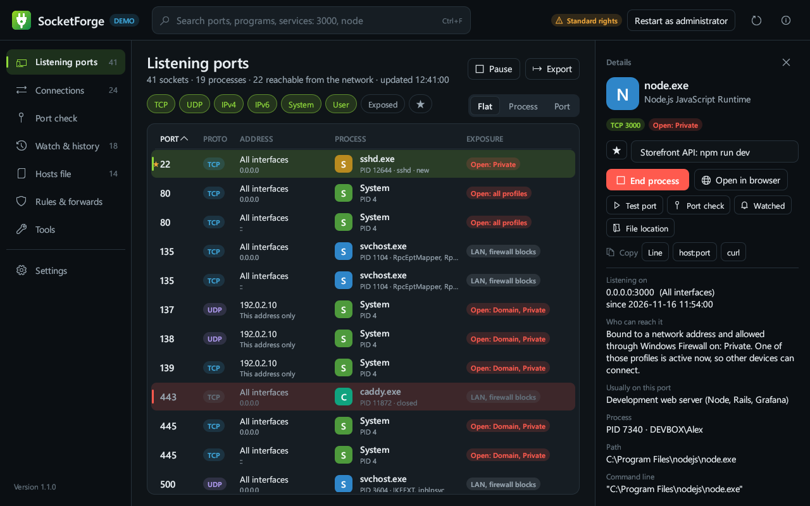</td>
</tr>
<tr>
<td width="50%" align="center"><b>Port check</b><br>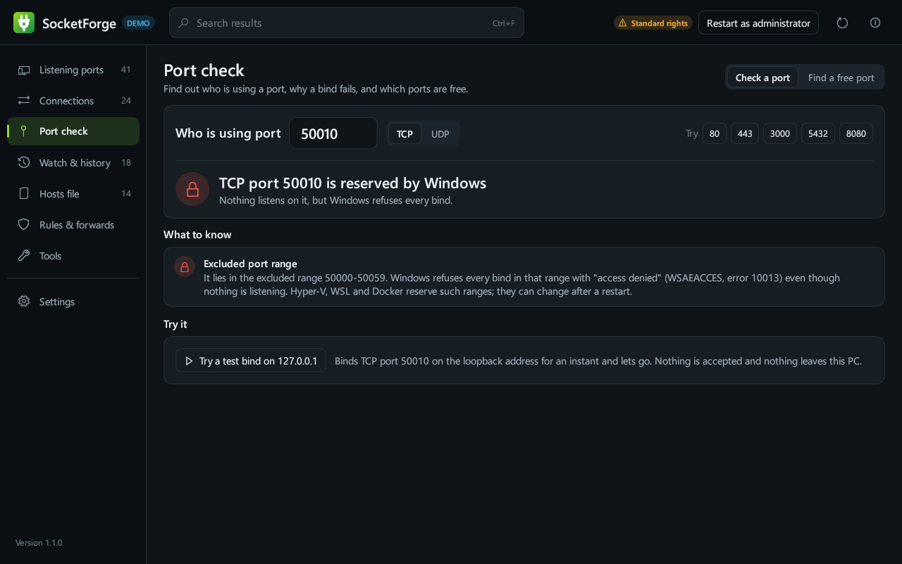</td>
<td width="50%" align="center"><b>Free port finder</b><br>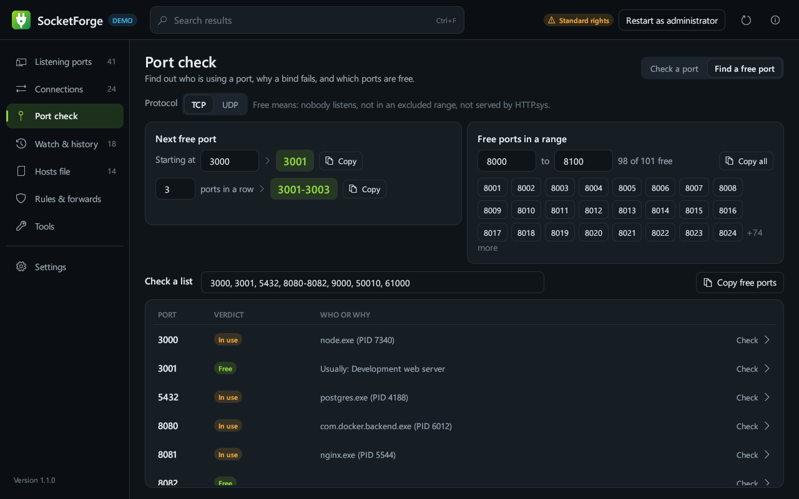</td>
</tr>
<tr>
<td width="50%" align="center"><b>Hosts file</b><br>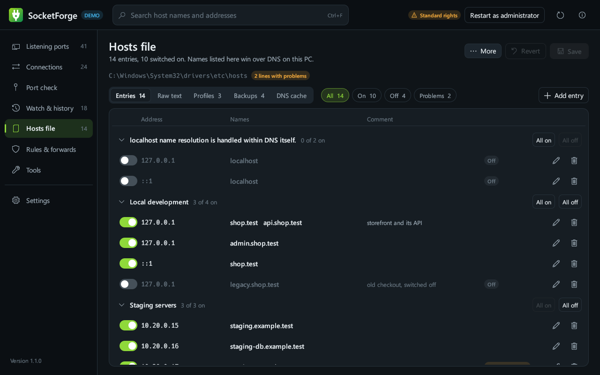</td>
<td width="50%" align="center"><b>Hosts profiles</b><br>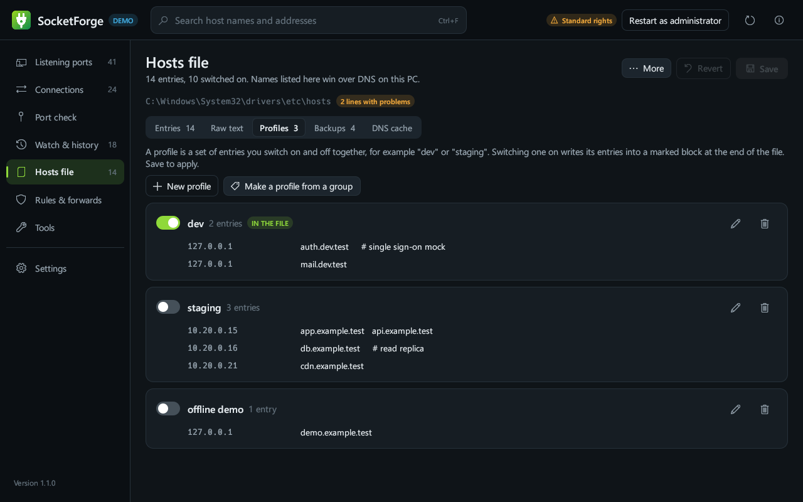</td>
</tr>
<tr>
<td width="50%" align="center"><b>Watch and history</b><br>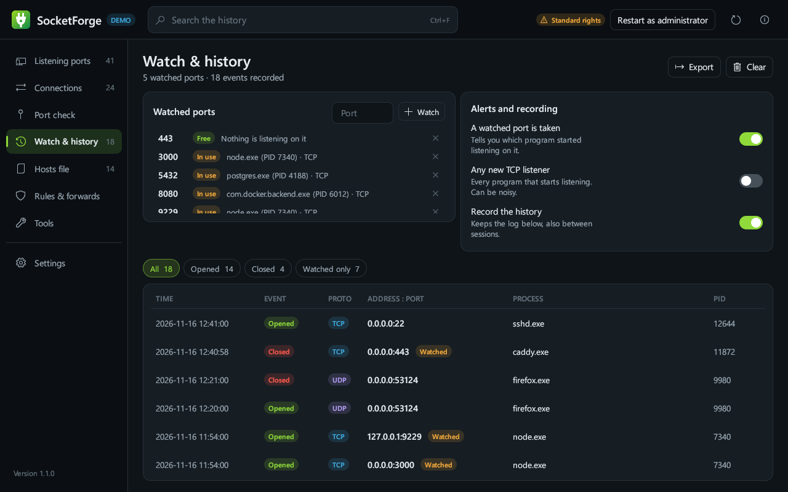</td>
<td width="50%" align="center"><b>Firewall rules</b><br>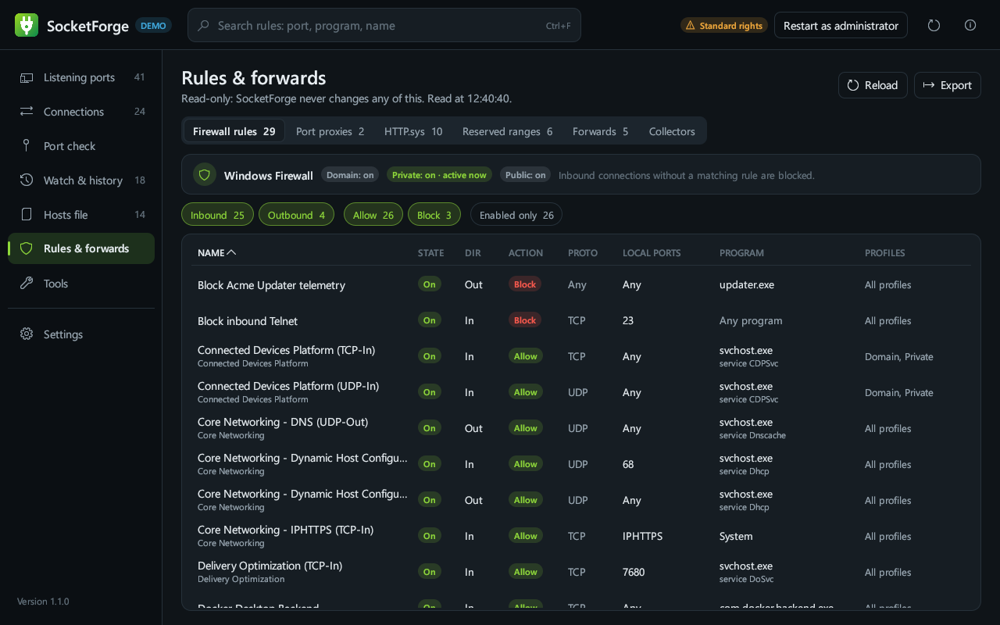</td>
</tr>
<tr>
<td width="50%" align="center"><b>Tools: serve a folder, forward a port</b><br>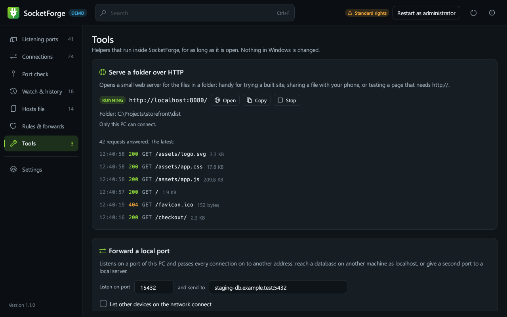</td>
<td width="50%" align="center"><b>Block-list import</b><br>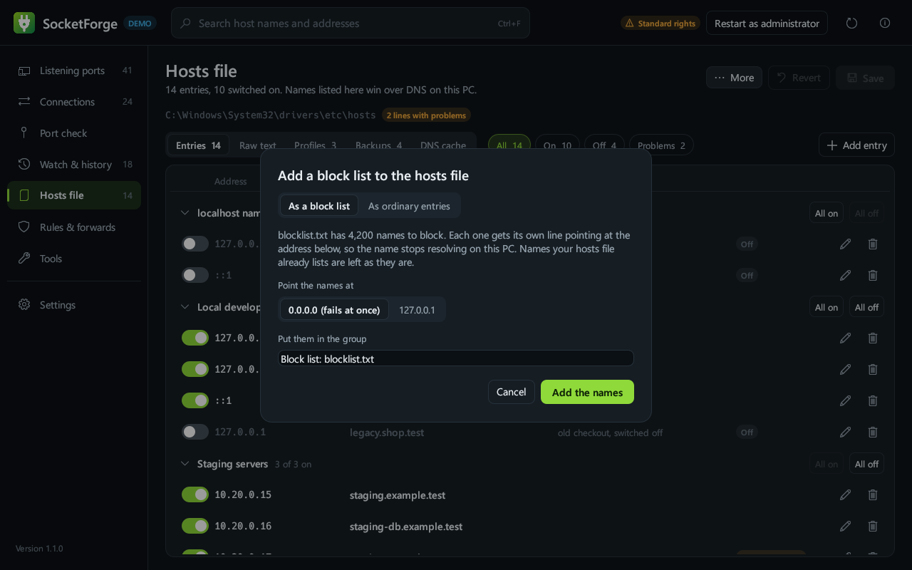</td>
</tr>
<tr>
<td width="50%" align="center"><b>Long hosts file, fast raw view</b><br>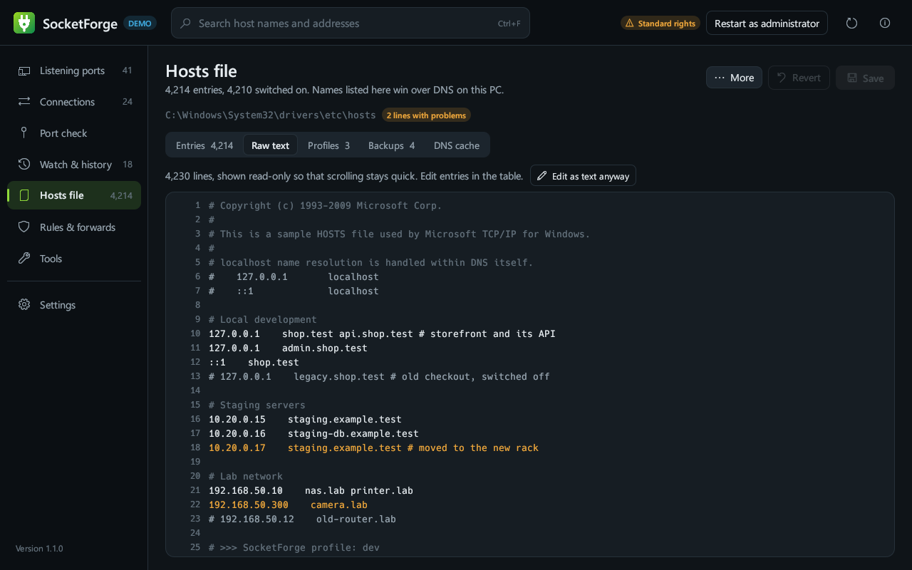</td>
<td width="50%" align="center"><b>DNS cache</b><br>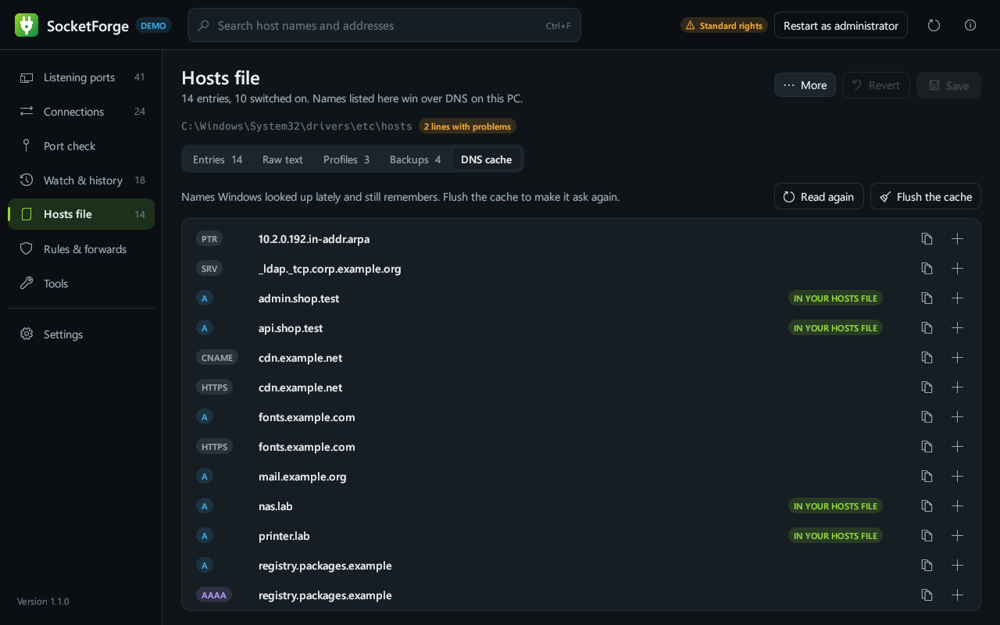</td>
</tr>
</table>

<sub>Screenshots use the built-in demo mode (<code>SocketForge.exe --demo</code>), with invented programs and addresses.</sub>

## 📥 Download

Get it from the [**latest release**](https://github.com/zheerkhalid/socketforge/releases/latest):

| File | What it is |
|---|---|
| `SocketForge-Setup.exe` | Per-user installer with shortcuts and an uninstaller |
| `SocketForge-x.y.z-portable-x64.zip` | Portable: unzip and run |
| `SocketForge.exe` | The bare 5.4 MB EXE |

SocketForge runs without administrator rights. **Restart as administrator** shows details of every process. Saving the hosts file asks for administrator rights at that moment, because Windows protects that file.

## ⌨️ Command line

| Command | What it does |
|---|---|
| `SocketForge.exe --port 3000` | Who is using port 3000 |
| `SocketForge.exe --list` | All listening ports |
| `SocketForge.exe --connections` | Active connections |
| `SocketForge.exe --free-from 8000` | The next free port from 8000 |
| `SocketForge.exe --demo` | Invented data |

From `cmd.exe`, use `start /wait SocketForge.exe ...` or pipe the output, because SocketForge is a windowed program.

## 📌 Good to know

- **What has been tested how.** The collectors, the hosts editor (on copies of the file), the folder server, the port forward and the command line are tested by running them against real listeners on this PC. Saving the real hosts file through the administrator prompt, stopping a service and the tray alerts have not yet been tested by hand.
- Firewall rules, port proxies and reservations are shown read-only; SocketForge does not change them.
- A hosts backup is made automatically before every save.
- Hosts files with more than 2,000 lines open read-only in the raw text view, so that scrolling stays quick; entries are edited in the table. "Edit as text anyway" still works, but typing is slow in a long file.
- Windows itself gets slow at looking up names when the hosts file holds several hundred thousand entries. Prefer a shorter block list.
- The folder server is a development helper: it has no passwords and no HTTPS, and it does not resume downloads. The folder server and the port forwards run only while SocketForge is open.
- The port forward passes TCP connections on; UDP is not forwarded.
- What changed in each version is in the [changelog](CHANGELOG.md).

## 🏗️ Build from source

Requires Rust (stable, MSVC toolchain) on Windows.

```powershell
git clone https://github.com/zheerkhalid/socketforge
cd socketforge
cargo build --release
# -> target\release\SocketForge.exe
cargo test
```

`SocketForge.exe --selftest` opens its own listeners, finds them, and checks that open and close events are recorded.

The icon is drawn in code at build time. The C runtime is linked statically, so the EXE runs on a clean Windows install.

## 👨‍💻 Developer

<table>
<tr>
<td align="center" width="140">
  <a href="https://zheer.dev">
    
  </a>
</td>
<td>

**Designed and developed by [Zheer Khalid](https://zheer.dev)**

🌐 Website: **[zheer.dev](https://zheer.dev)**  
🐙 GitHub: **[@zheerkhalid](https://github.com/zheerkhalid)**  
🧩 Also by Zheer: **[SnapForge](https://github.com/zheerkhalid/snapforge)**, **[ReelForge](https://github.com/zheerkhalid/reelforge)**, **[UnForge](https://github.com/zheerkhalid/unforge)**, **[KeepForge](https://github.com/zheerkhalid/keepforge)**, **[ShredForge](https://github.com/zheerkhalid/shredforge)**, **[BootForge](https://github.com/zheerkhalid/bootforge)**, **[WireForge](https://github.com/zheerkhalid/wireforge)**, **[TwinForge](https://github.com/zheerkhalid/twinforge)**, **[SpaceForge](https://github.com/zheerkhalid/spaceforge)**, **[RescueForge](https://github.com/zheerkhalid/rescueforge)**, **[FindForge](https://github.com/zheerkhalid/findforge)**, **[HourForge](https://github.com/zheerkhalid/hourforge)** and **[PulseForge](https://github.com/zheerkhalid/pulseforge)**

If SocketForge is useful to you, a ⭐ on the repo is appreciated.

</td>
</tr>
</table>

## 📄 License

MIT © 2026 [Zheer Khalid](https://zheer.dev). See [`LICENSE`](LICENSE).

<div align="center">
<sub>Built with 🦀 Rust and ❤️ by <a href="https://zheer.dev">zheer.dev</a></sub>
</div>
